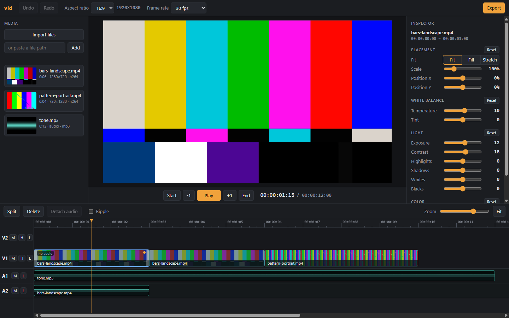

# vid

A small local video editor: import of video and audio files, a timeline with
two video and two audio tracks, aspect-ratio change, colour correction, and export. A Node server on 127.0.0.1 plus a browser UI;
FFmpeg does probing, thumbnails and the final render. It runs in the browser
or as an Electron desktop app, and brings its own ffmpeg and ffprobe.

## Run

Needs Node 22+.

    npm install          # Electron, the builder, and ffmpeg / ffprobe binaries
    npm start            # browser version: then open http://127.0.0.1:5175
    npm run app          # desktop version: the same editor in an Electron window
    npm run dist         # build an installer for this platform into dist/
    npm run samples      # optional: writes two test videos and a tone to samples/
    npm test             # unit tests for the model, colour, geometry and export graph
    npm run smoke        # drives the real page in headless Chrome end to end

`PORT` and `VID_DATA_DIR` change the port and where the project, cache and
exports are kept (default `data/`).

**ffmpeg / ffprobe** come from the `ffmpeg-static` and
`@ffprobe-installer/ffprobe` packages, so nothing has to be on PATH. Set
`VID_FFMPEG` / `VID_FFPROBE` to use other binaries; if the packages are not
installed, the ones on PATH are used.

**Desktop app** (`electron/main.js`): starts the same server inside the app on a
free loopback port. The project and caches live in the per-user app data folder
and exports go to `Videos/vid` (File > Open exports folder). `npm run dist`
uses electron-builder (config under `build` in `package.json`) and packs the
binaries for the platform it runs on: an NSIS installer on Windows, a dmg on
macOS, an AppImage on Linux. The build is unsigned and uses the default icon.

## Using it

- **Import**: "Import files", paste a path, or drop files on the window.
- **Timeline**: drag a card onto a track or double-click it. Drag clips to move,
  drag their edges to trim, `S` splits at the playhead, `Delete` removes.
  "Ripple" makes deletes, trims and inserts slide the later clips.
  M / H / L on a track = mute, hide, lock.
- **Audio**: audio files (mp3, wav, m4a, flac, ogg...) go on A1/A2 and video
  files on V1/V2; a clip dropped on the wrong kind of track lands on the right
  one. Audio clips are mixed on top of the sound of the picture, each with its
  own volume, and the timeline runs to the end of the longest track (black
  picture once the video is over).
- **Detach audio**: select video clips and press "Detach audio". Each clip's
  sound becomes a clip of its own on the first audio track that is free under
  it (same position, trim and volume) and the video clip goes silent ("no
  audio" badge). The two are then independent: move, trim, split or delete
  either one. Undo puts the sound back.
- **Aspect ratio**: the top-bar select. Clips keep their settings and re-fit;
  Fit / Fill / Stretch, Scale and Position are per clip in the inspector.
- **Colour**: ten sliders per clip (white balance, light, colour).
- **Keys**: Space play, Left/Right step a frame (Shift = 10), Home/End,
  Ctrl+Z / Ctrl+Shift+Z.
- **Export**: H.264 + AAC MP4 at the project size, written to `data/exports/`.

## How it is built

| Step | Files | What it adds |
| --- | --- | --- |
| 1. Core | `shared/time.js`, `model.js`, `history.js` | Integer time, the project document, every edit as a plain function, snapshot undo with transactions |
| 2. Import | `server/media.js` | ffprobe, thumbnail, fingerprint cache, H.264 proxy for files the browser cannot play |
| 3. Preview | `web/renderer.js`, `player.js` | WebGL2 canvas; playhead follows the video clock |
| 4. Timeline | `web/timeline-view.js`, `shared/model.js` | Move, trim, split, snapping; free and ripple edit policies |
| 5. Aspect | `shared/geometry.js` | One `destRect()` used by both preview and export |
| 6. Colour | `shared/color.js` | One `gradePixel()` baked to a 33³ LUT: a 3D texture in the preview, a `.cube` file for FFmpeg's `lut3d` on export |
| 7. Export | `shared/segments.js`, `server/exporter.js` | Flatten the tracks to spans, build one FFmpeg filter graph |
| 8. Audio | `shared/model.js`, `web/player.js`, `server/exporter.js` | Track and media kinds, waveform posters, `<audio>` elements slaved to the playhead, `adelay` + `amix` on export |

## Limits

- No stills or titles; two video and two audio tracks.
- Of the video clips with their sound still attached, only the visible one is
  heard. Detached audio is not linked to its picture (moving one does not move
  the other) and cannot be re-attached except by undo. No fades or keyframes.
- The upper track simply covers the lower one: no blending, opacity or transitions.
- Preview volume stops at 100 %; the export applies the full 0-200 %.
- Colour is applied to display-referred 8-bit values; no HDR or colour management.
  Sources without complete colour tags are assumed BT.709 at HD sizes and BT.601
  below, which is what Chrome does.
- Undo keeps whole-project snapshots (fine at this size, not for huge projects).
- Tested in Chrome only.

## Licence

vid's source code is under the MIT License (`LICENSE`). The built desktop app
also contains FFmpeg (GPL v3) and Electron; see `THIRD-PARTY-NOTICES.md`, which
is copied into the app together with the licence texts.
